# Ledgerline

**⚠️ Free, open-source educational tool. Not tax advice. No warranty. Does not e-file. Read the [Disclaimer](DISCLAIMER.md) before use.**

Ledgerline is a free helper that runs in your web browser and estimates a **2025 U.S. Form 1040** (the main federal income-tax form). It asks one question at a time. Your answers stay in this browser on this computer.

**It is not tax advice. It cannot send a return to the IRS. Check every number yourself.**

## Contents

1. [Disclaimer](#disclaimer)
2. [What you can do with it](#what-you-can-do-with-it)
3. [A picture walkthrough](#a-picture-walkthrough)
4. [Is my information safe?](#is-my-information-safe)
5. [How to run it on your own computer](#how-to-run-it-on-your-own-computer)
6. [What it does NOT do](#what-it-does-not-do)
7. [Known issues](#known-issues)
8. [FAQ](#faq)
9. [Help improve Ledgerline](#help-improve-ledgerline)
10. [License](#license)
11. [Rounding](#rounding)
12. [Project layout](#project-layout)

## Disclaimer

Read the full text in [`DISCLAIMER.md`](./DISCLAIMER.md) before use. The same full notice is shown on first run in a scroll box. You must check *I have read the disclaimer and understand Ledgerline is not tax advice and I am solely responsible for my return* before **Start** or **Load a sample return**. Acknowledgment is stored in this browser only, under `ledgerline.disclaimer.v2`. The app footer and print view keep a short line that links to the in-app `/disclaimer` page.

> [!WARNING]
> **Please read this first.** Ledgerline is not the IRS. It is not a tax professional. It cannot file your return for you.
>
> Ledgerline is an educational and tax-preparation aid for the 2025 Form 1040. It is not tax, legal, or financial advice, and it is not a substitute for official IRS forms, instructions, or publications.
>
> There is no warranty of any kind. The software is provided “as is” under the GNU Affero General Public License version 3 or later; see LICENSE sections 15 and 16 for the full warranty disclaimer and limitation of liability.
>
> You are responsible for checking every figure against the IRS instructions and for any return you file. Ledgerline does not e-file.
>
> Ledgerline is not affiliated with, endorsed by, or approved by the Internal Revenue Service or any accounting or law firm.
>
> All data stays in this browser. Ledgerline does not create accounts and does not send your return data to a server.
>
> **LEDGERLINE IS A FREE, COMMUNITY, OPEN-SOURCE PROJECT FOR EDUCATIONAL PURPOSES ONLY. USE IT ENTIRELY AT YOUR OWN RISK.**
>
> Nothing in this software, its calculations, its documentation or its repository is tax, legal, accounting, investment or financial advice. Using Ledgerline does **not** create a CPA-client, enrolled agent-client, attorney-client, tax preparer-client, fiduciary or any other professional relationship. No licensed professional prepared, reviewed, signed or approved any return, figure or result Ledgerline produces. Ledgerline does not provide "written advice" under Treasury Circular 230.
>
> Ledgerline is provided **"as is" and "as available," without warranty of any kind**. The software is **incomplete**. Figures may be **outdated, incomplete or simply wrong**. **You are solely responsible** for every figure you rely on and every return you file. The authors, contributors, maintainers and anyone who distributes Ledgerline **are not liable** for taxes, penalties, interest, audit costs, lost refunds, or other damages.

**Please also know:**

- Do not file a Ledgerline result without reviewing every line against official IRS forms and instructions.
- When required facts are missing, the app says **Incomplete — preview only**. That preview is not a complete refund, tax, or amount-owed claim.
- Ledgerline can be wrong. Tests catch many mistakes. They do not make the result safe to file as-is.
- The built-in cross-check in `src/oracle` was written by the same author as the tax engine. It is not an independent review. It is not a guarantee of accuracy.
- Ledgerline does not replace a tax professional, the IRS, or official IRS publications.
- Pictures in this README use fake sample names and numbers. They are not a real tax return.

## What you can do with it

- Answer plain questions about you, your household, wages, interest and dividends, a small business, and deductions.
- Watch a live estimate of a federal **refund** (money back) or **amount owed** (money still to pay).
- Review Form 1040 line numbers and the schedules Ledgerline fills from your answers.
- Open a print-friendly summary. Print is for your review. It is not an official IRS form.
- Keep work in this browser on this computer. You will see “Saved in this browser” at the top.
- If this browser cannot save, download a recovery copy of your answers to a file on this computer.
- Read the known-issues list ([`KNOWN_ISSUES.md`](./KNOWN_ISSUES.md), and `/known-issues` in the running app) and the Rules & Why page (`/rules` in the running app).
- Run the same checks this project uses: unit tests, a same-author cross-check, and a click-through test.

The interview can cover W-2 wages, interest and dividends (Schedule B), self-employment (Schedule C and SE tax), itemized vs. standard deduction (Schedule A, including the 2025 SALT cap), the child tax credit and credit for other dependents, the qualified business income deduction (Form 8995 / 8995-A), Schedule D / Form 8949, alternative minimum tax, the earned income credit, and 2025 Schedule 1-A deductions. “Can cover” does not mean every real-life case is handled. See [What it does NOT do](#what-it-does-not-do).

## A picture walkthrough

These pictures use **fake sample people only**: Jane Sample and a child named Pat. The employer is “Sample Employer Co.” Ledgerline does not ask you to type a Social Security number. Do not type real personal facts into a screenshot, a shared computer, or this README.

### 1. Read the notice and start

The first screen is a warning. You must check the box before Ledgerline will create a return.

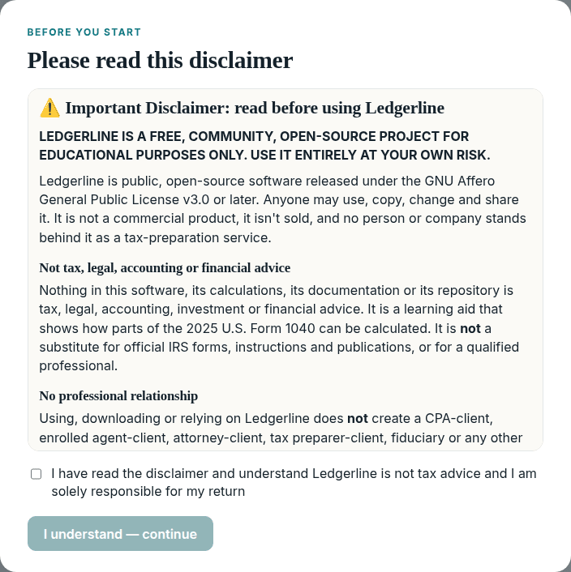

**1. The first screen is a warning you have to read.** Ledgerline will not let you start a return until you check the box.

After you accept, you see the start page. You can start a blank return or load the built-in sample (a different fake household used by the tests).

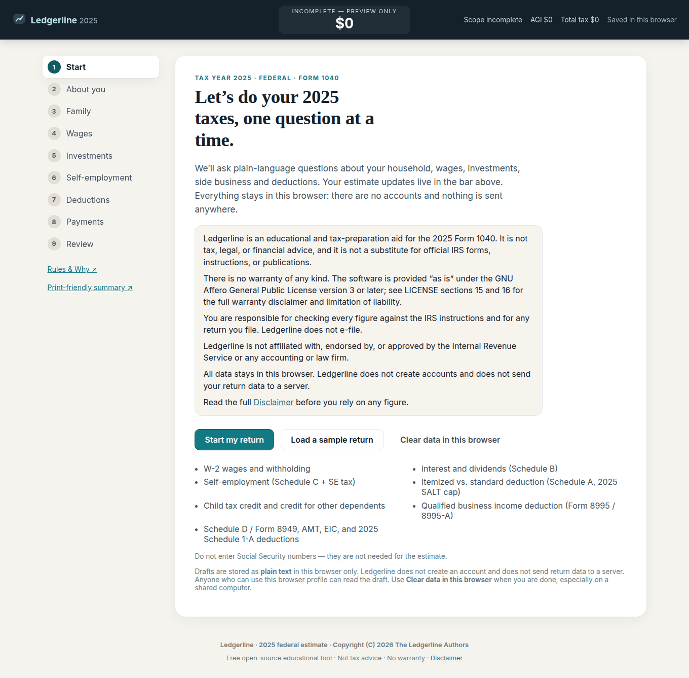

**2. This is the start page.** The dark bar at the top is the estimate. It stays with you as you answer questions.

### 2. Tell Ledgerline about you

Tap **Start my return**. Type a first and last name. Choose a filing status (how you file: single, married filing jointly, and so on). Answer the yes/no questions. In this picture, the fake person is Jane Sample, age 40, filing single.

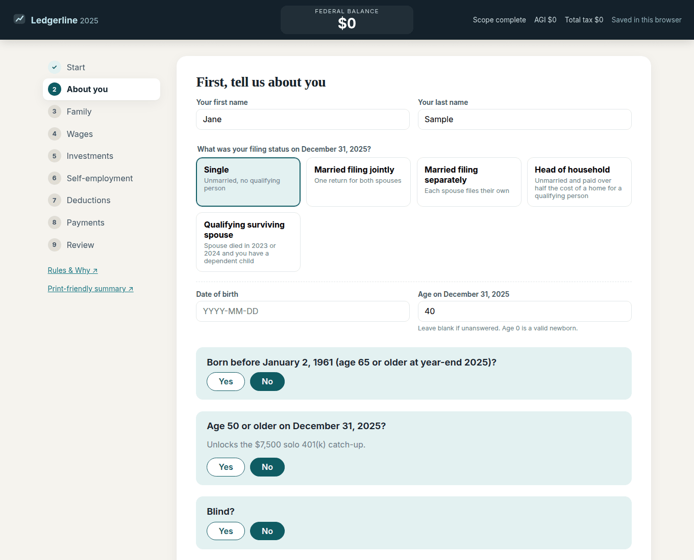

**3. This is the “about you” page.** A later yes/no question asks whether a Social Security number is valid for work. Ledgerline never asks you to type the number itself.

### 3. Answer household questions

Say whether you can claim any dependents (people you support who may belong on the return). Here Jane claims one fake child named Pat.

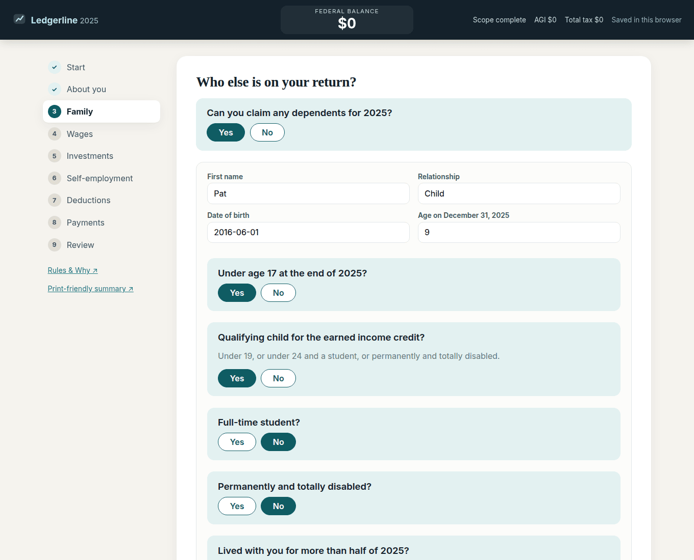

**4. This is the household page.** Later questions ask whether the child lived with you and whether a Social Security number is valid for work. Credits stay off until those are answered. You still never type the number.

### 4. Enter a W-2

A **W-2** is the wage statement an employer gives you. Copy the box numbers from that paper. Here the fake employer is Sample Employer Co., with $42,000 of wages and $5,500 already withheld (taken out of the paycheck for federal tax).

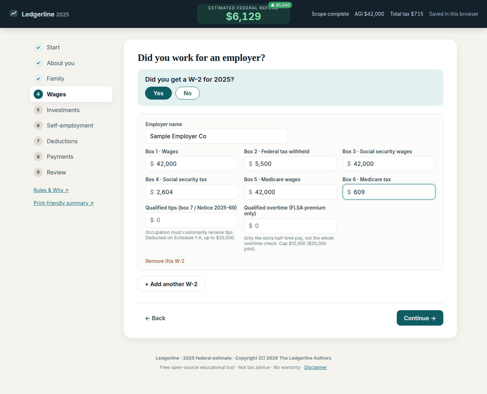

**5. This is the W-2 page.** The top bar updates as soon as wages and withholding are entered. Until every required fact is answered, that bar may still say the result is incomplete.

### 5. Check deductions and payments

A **deduction** reduces the income that is taxed. Ledgerline compares the standard deduction (a set dollar amount from the IRS) with itemized deductions (certain amounts you paid). It uses the larger one unless you tell it otherwise.

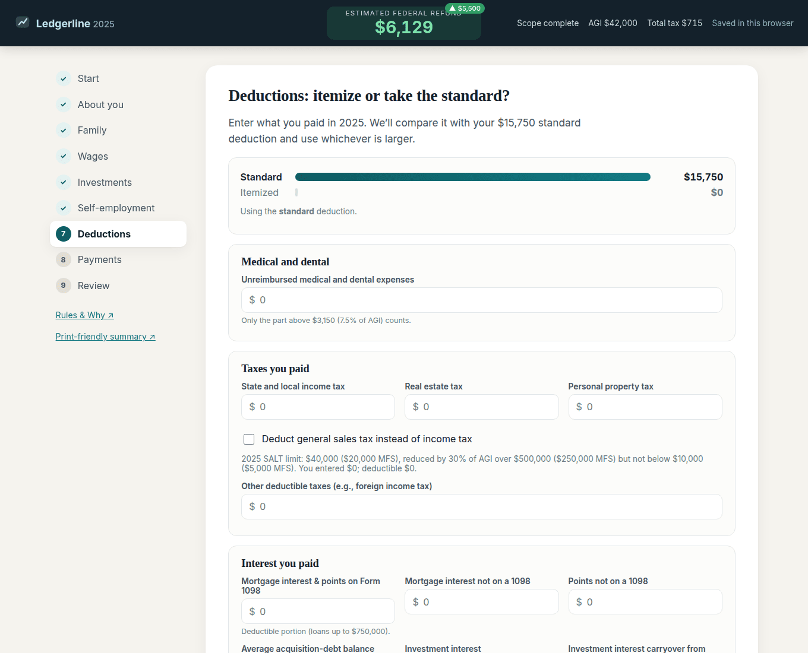

**6. This is the deductions page.** Jane entered no extra itemized amounts, so Ledgerline uses the standard deduction.

Next, tell Ledgerline about tax you already paid besides W-2 withholding, such as quarterly estimated payments.

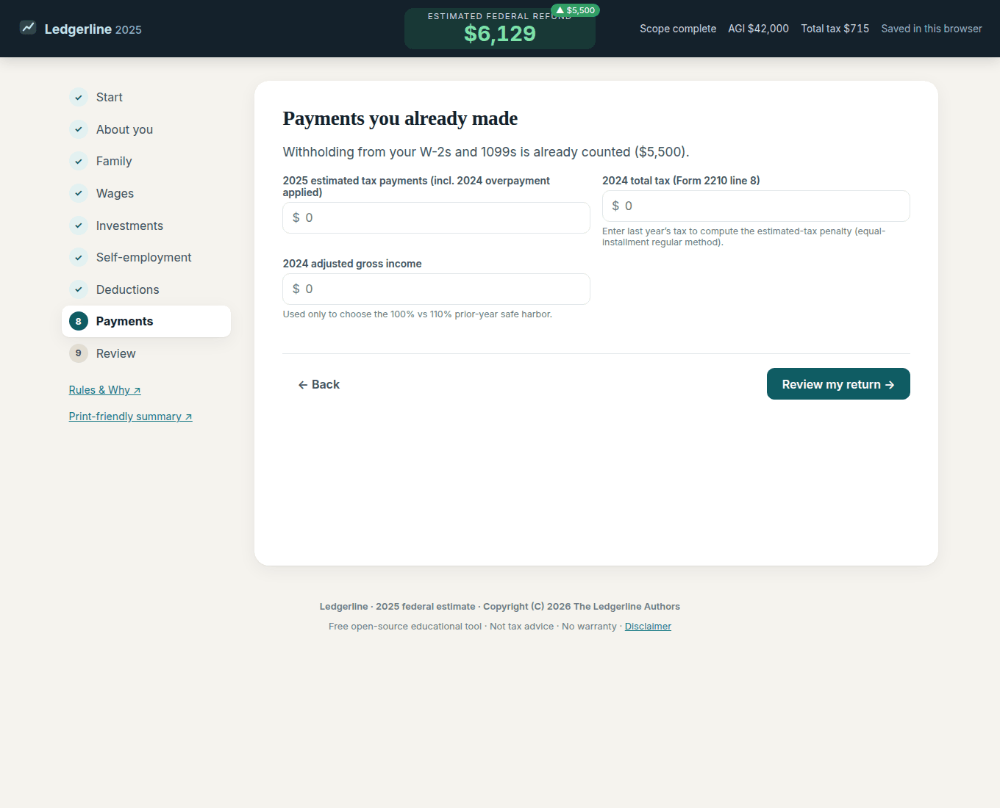

**7. This is the payments page.** Withholding from the W-2 is already counted. You can add estimated payments if you made them.

### 6. See the refund or amount owed

When the interview is complete enough, the review page shows a **refund** (money back) or an **amount owed** (money still to pay). That number is an estimate. It is not a promise. It is not ready to file without your review.

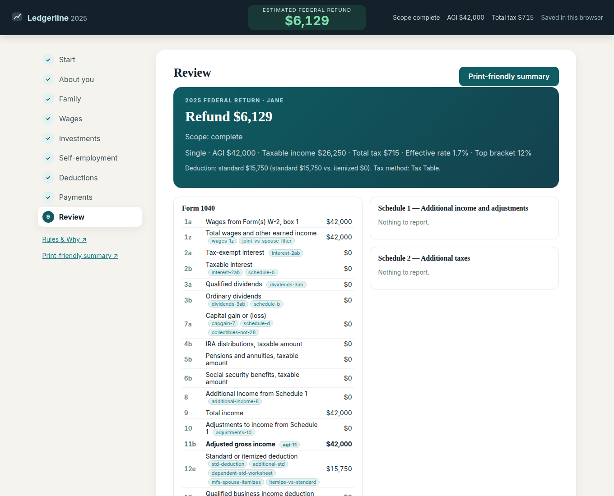

**8. This is the review page.** It names the fake sample person and shows the estimated refund or amount owed.

Scroll down to see Form 1040 line by line. These are the same line numbers as the IRS form. They are still an estimate.

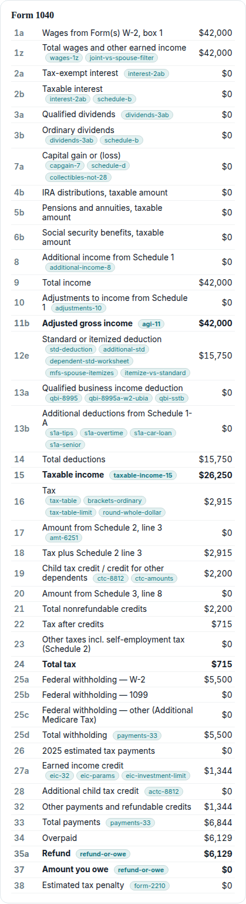

**9. This is the Form 1040 line list.** Use it to compare Ledgerline with the official form and instructions.

You can also open a print-friendly summary. The summary itself says it is an estimate, not for filing.

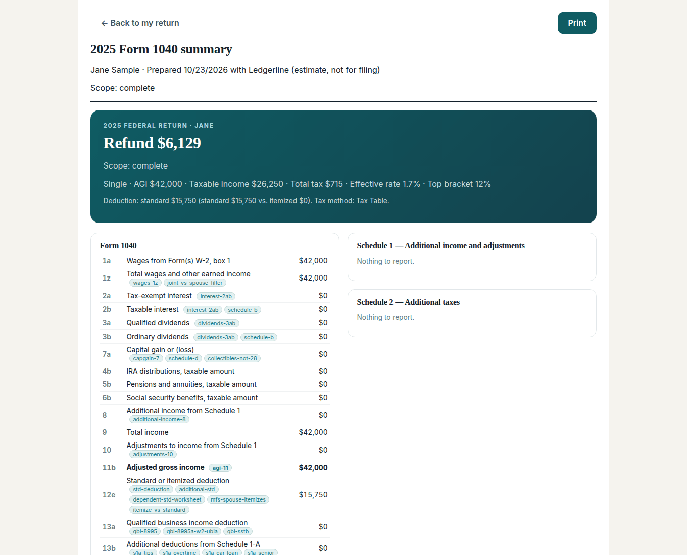

**10. This is the print-friendly summary.** Print it for your own review. Do not treat it as an official IRS form.

### 7. Save, print, or download a recovery copy

As you go, Ledgerline writes your answers into this browser. The top bar says **Saved in this browser** when that write works.

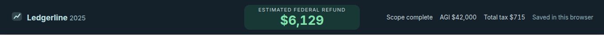

**11. The top bar shows the estimate and the save status.** “Saved in this browser” means the answers are on this computer, in this browser profile, not on a Ledgerline server.

If this browser refuses the save (for example, storage is full), Ledgerline shows a warning and a **Download a recovery copy** button. That button writes a file on your computer named `ledgerline-ty2025-return.json`. That file has your tax answers. Keep it private. Ledgerline does not upload that file. There is no “open this file” button in the app. The usual way to keep working is to stay in the same browser on the same computer.

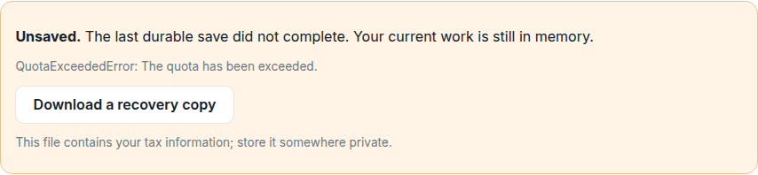

**12. This warning appears only when the browser cannot save.** Use the button to keep a private copy on your computer.

### 8. Read the known-issues page

Ledgerline does not handle every tax situation. The running app has a `/known-issues` page, and this repository has [`KNOWN_ISSUES.md`](./KNOWN_ISSUES.md). Read them before you rely on a number.

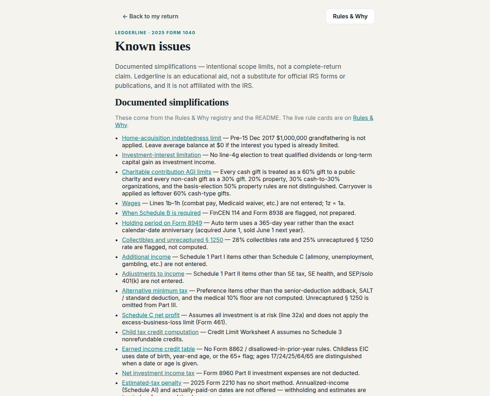

**13. This is the known-issues page.** It lists shortcuts in the math and things that are out of scope.

There is also a Rules & Why page at `/rules` in the running app. It shows the tax rules Ledgerline used and links toward the IRS source for each one.

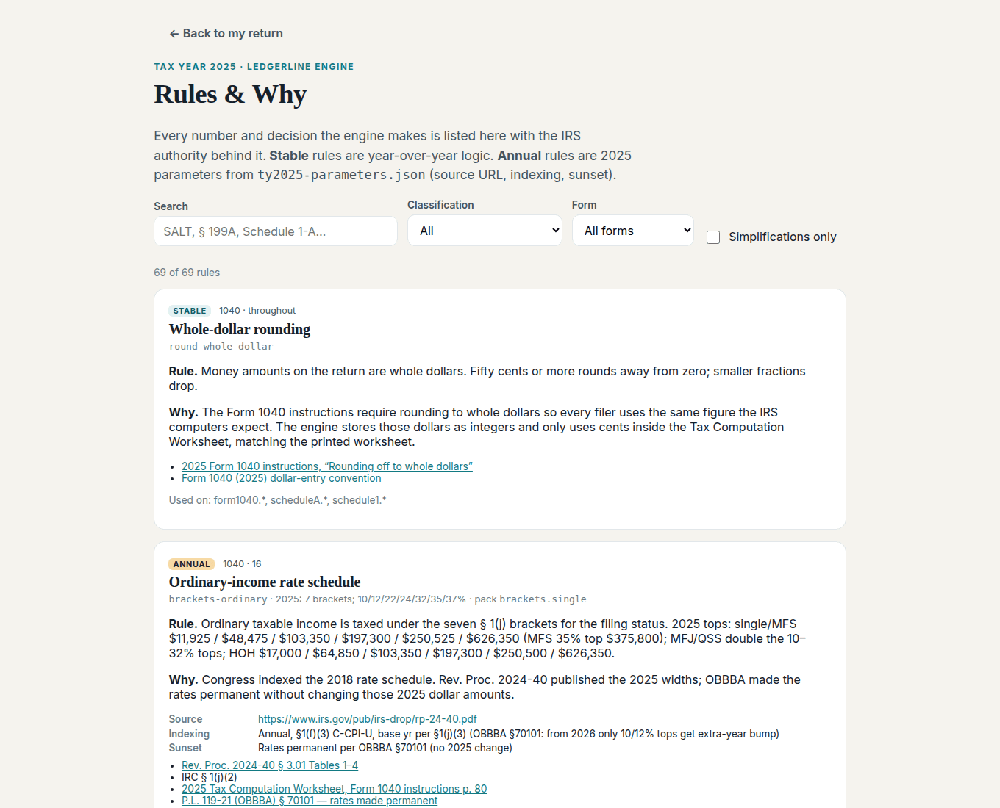

**14. This is the Rules & Why page.** It is a study aid. It is not an IRS publication.

The same legal notice stays at the bottom of the app after you accept it.

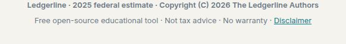

**15. The footer repeats the same notice.** You can read it again at any time.

To remake these pictures after the screens change:

```bash
npm run screenshots
```

That command builds the app, opens it the way a visitor would, fills the fake Jane Sample walkthrough, writes PNGs into `docs/screenshots/`, and refreshes the binary hashes used by the public-release gate.

## Is my information safe?

Here is what the code actually does. This is not a promise that nothing can ever go wrong on your computer.

- **Where answers are stored.** Return answers are saved in this browser’s `localStorage` (a small storage box inside the browser) under the key `ledgerline.ty2025.v1`. See `src/lib/storage.ts`.
- **Where the “I understand” check is stored.** That check is saved separately under `ledgerline.disclaimer.v2`. See `src/lib/disclaimer.ts`. An older `v1` check is ignored, so everyone sees the current full disclaimer.
- **No Ledgerline account.** The app does not create a username or password.
- **No send-to-server step in the app.** The app code writes return data to `localStorage` and, if you ask, to a file you download. It does not post your return to a Ledgerline server. An automated click-through test (`e2e/sample-return.spec.ts`) fails if filling a return makes an HTTP request to a host other than `localhost` / `127.0.0.1`.
- **Not encrypted.** `localStorage` is plain text inside the browser. Anyone who can use this browser profile can read the answers. Browser extensions can read it too.
- **Shared or public computers.** Do not enter a real return on a computer other people use. Use **Clear data in this browser** when you are done. That control erases the draft and the disclaimer check. Clearing this site’s browser data also erases the saved return.
- **The recovery file.** `ledgerline-ty2025-return.json` is a copy of your answers. Store it the way you would store tax papers. Ledgerline does not receive it.
- **If you put the app on a website.** Other people would download the program files from that site. Your *answers* still live in each visitor’s own browser unless that visitor downloads a recovery file or you add something this project does not include.
- **Do not type a Social Security number.** The interview asks only whether a number is valid for work. The start page says Social Security numbers are not needed for the estimate.

## How to run it on your own computer

You need [Node.js](https://nodejs.org/) 22 or newer (the program that runs this project) and a copy of this source.

```bash
git clone https://github.com/CJs-Ideas2Life/ledgerline.git
cd ledgerline
npm install
npm run dev
```

Then open [http://localhost:3210](http://localhost:3210) in your browser. The first screen is the notice. You must check the box before a return can be created.

Useful commands:

```bash
npm run dev          # try it locally at http://localhost:3210
npm run build        # make the production files
npm start            # serve those files at http://localhost:3210
npm test             # Vitest: engine unit tests + test-data/ library
npm run typecheck
npm run scorecard    # same-author cross-check report (not an independent review)
npm run e2e          # Playwright click-through (Chrome locally; Chromium in CI)
npm run screenshots  # rebuild the README pictures from the production app
```

## What it does NOT do

- Give tax, legal, or financial advice.
- E-file (send a return to the IRS over the internet).
- Prepare a state tax return.
- Replace official IRS forms, instructions, or publications.
- Cover tax years other than **2025**.
- Handle every Form 1040 situation. Education and other Schedule 3 credits, Form 1116 (foreign tax credit), Form 8839 / Form 1040 line 30, Form 8962 (premium tax credit), Form 8615 / Form 8814 (kiddie tax forms), FinCEN 114, Form 8938, and Form 4562 are out of scope. ISO / depreciation AMT preferences and the 28% collectibles and 25% unrecaptured-§1250 worksheets are not computed (declaring those facts blocks a complete result). The pre-15 Dec 2017 $1 million mortgage grandfather rule is not applied.
- Guarantee that a number is correct. There is no warranty.
- Speak for the IRS or any accounting or law firm.
- Offer an independent check of its own math. The `src/oracle` cross-check is separately written by the same author.

A **complete** result in the app only means “the facts you entered are inside the supported 2025 scope.” It does not mean “safe to file.”

## Known issues

Documented simplifications and other scope limits are listed in [`KNOWN_ISSUES.md`](./KNOWN_ISSUES.md). The same list is in the app at `/known-issues`. Update both when a listed limit is implemented. Ledgerline is not affiliated with the IRS.

In short, and in plain words:

- Some charity, mortgage-interest, and investment-interest details are simplified.
- Some Form 1040 wage lines (1b–1h) are not entered.
- Some extra income and adjustment lines on Schedule 1 are not entered.
- Alternative minimum tax, net investment income tax, and the estimated-tax penalty cover only part of those forms.
- The earned income credit uses the official 2025 table. It does not apply Form 8862 / prior-year disallowance rules.
- Holding period on Form 8949 uses a 365-day year, not the exact calendar-date anniversary.

Read the full list before you rely on a number.

## FAQ

**Is this approved by the IRS?**
No. Ledgerline is not affiliated with, endorsed by, or approved by the IRS.

**Can I e-file with it?**
No. Ledgerline does not e-file.

**Can I send the printout to the IRS as my return?**
No. The printout is an estimate for your review. Use official IRS forms. Check every figure.

**Will it do my state return?**
No.

**Where does my information go?**
Into this browser on this computer, under `ledgerline.ty2025.v1`. The app does not create an account and does not send return data to a server. See [Is my information safe?](#is-my-information-safe).

**What tax year does it cover?**
2025 only.

**Do I type my Social Security number?**
No. Ledgerline does not need the number for the estimate.

**The top bar says “Incomplete — preview only.” What does that mean?**
Some required facts are still missing, or the case is outside the supported scope. That bar is not a complete refund or amount-owed claim.

**What is the “oracle” or scorecard?**
A second, simpler walk of Form 1040 that lives in `src/oracle`. It does not import the engine’s math. It was written by the same author. It is a separately written cross-check, not an independent assessment.

**The built-in sample return looks detailed. Is that a real person?**
No. The **Load a sample return** button uses a fictional household (Alex and Jordan Rivera) for tests. The pictures in this README use a different fictional person (Jane Sample). Neither is a real taxpayer.

**May I use this to file if the review page looks complete?**
You are responsible for checking every figure against the IRS instructions and for any return you file. Ledgerline does not e-file. Do not file a Ledgerline result without that review.

## Help improve Ledgerline

Useful feedback makes the next person's experience better. Keep it fictional.

| You can help with… | Bring… |
|---|---|
| Tax correctness | A minimal made-up case, the affected line, and the exact-year IRS instructions or worksheet that support the expected result. |
| Ease of use | The question you could not answer, the words you expected, and a screenshot that uses fake data only. |
| Missing coverage | The situation and required forms, plus how the app should explain its limit until support exists. |
| Code | A focused change, a reproduced failure, and a check against the same path a visitor uses. |

Never attach real returns, Social Security numbers, bank details, credentials, or client files. Vulnerabilities belong in the private route in [`SECURITY.md`](./SECURITY.md).

A short first-time tour: read the disclaimer, start a fictional return, answer household questions (eligibility facts matter as much as dollar amounts), add a simple W-2, open Review, then try the print-friendly summary. The 165 authored cases in [`test-data/`](./test-data/README.md) are examples and regression fixtures, not evidence that every real return is correct.

## License

Copyright (C) 2026 The Ledgerline Authors

Ledgerline is free software under the GNU Affero General Public License version 3 or later. See `LICENSE`, `NOTICE`, and [`DISCLAIMER.md`](./DISCLAIMER.md).
Source files under `src/` carry `SPDX-License-Identifier: AGPL-3.0-or-later`.

`NOTICE` states:

```
Copyright (C) 2026 The Ledgerline Authors

This product is licensed under the GNU Affero General Public License
version 3 or later. See LICENSE.
```

## Rounding

Whole-dollar method throughout: each input and computed line is rounded to the nearest dollar (50 cents rounds up),
as the Form 1040 instructions permit. Tax under $100,000 uses the Tax Table (tax on the row midpoint), at or above
$100,000 the Tax Computation Worksheet.

## Project layout

- `src/engine/` — pure, framework-free tax engine (no React, no I/O)
  - `constants2025.ts` — every 2025 figure with its IRS source URL and location
  - `taxComputation.ts` — rate schedules, Tax Table (row midpoints), Tax Computation Worksheet, QDCG worksheet
  - `compute.ts` — Form 1040 + Schedules 1, 1-A, 2, A, B, C, D, SE, 8812, Forms 8995 / 8995-A, 6251, 4952, 2210, 8949, 8959, 8960
- `src/components/` — interview UI, live refund/owed meter, review tables
- `src/app/print/` — print-friendly summary
- `tests/engine/` — unit tests; `taxTable2025.json` is the full 2025 Tax Table and `eicTable2025.json` is the official EIC table, both parsed from the IRS 2025 instructions PDF
- `test-data/` — 165 synthetic 2025 returns with hand-figured expected lines (see `test-data/README.md`)
- `src/oracle/` — a separately written Form 1040 cross-check that does not import engine code (same author as the engine; not an independent assessment)
- `DISCLAIMER.md` — full protective notice (also at `/disclaimer` in the running app)
- `KNOWN_ISSUES.md` — documented simplifications and other scope limits (also at `/known-issues`)
- `e2e/` — Playwright walkthrough; screenshots land in `artifacts/`
- `docs/screenshots/` — pictures used in this README (regenerate with `npm run screenshots`)
- `.github/workflows/ci.yml` — typecheck, `npm test`, and Playwright on every push and PR
- `docs/sources/SHA256SUMS` — hashes of the IRS PDFs used for verification (PDFs themselves are git-ignored)
